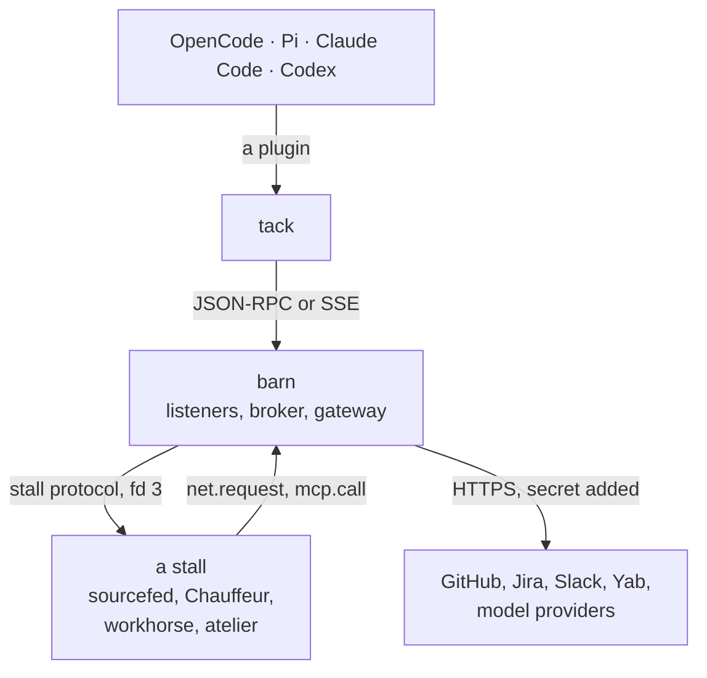
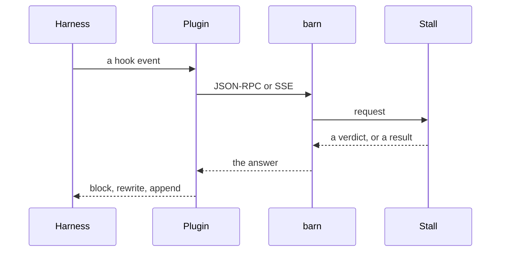
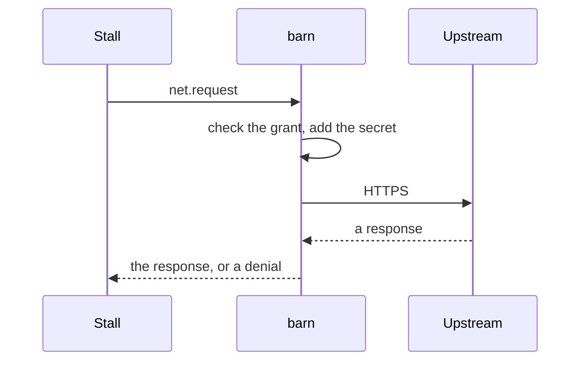
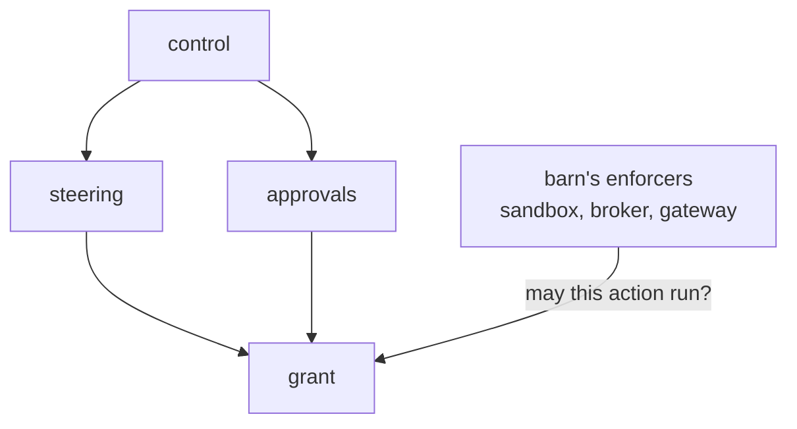
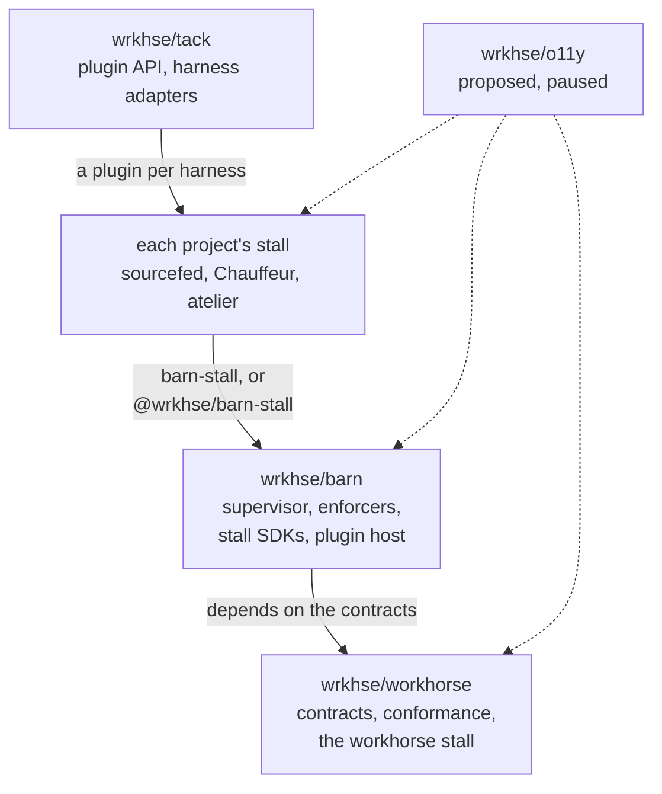
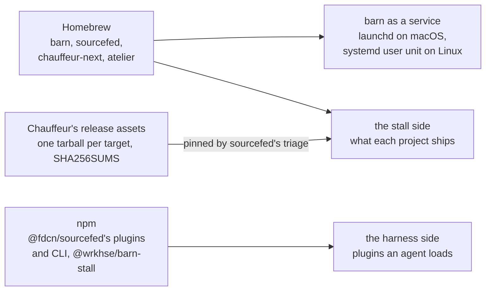
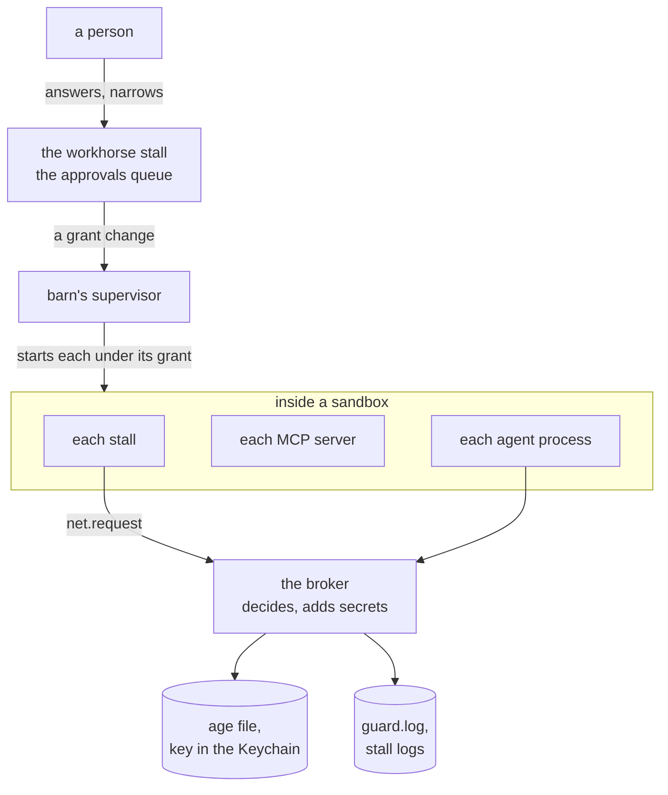

# Architecture

**Status:** being built. barn's repository and its gates are in place (slice B0);
the supervisor, the contracts and the stalls follow. Each part below carries its
own status, and the picture is the system with every approved plan complete.
[The barn plan](https://github.com/wrkhse/barn/issues/1) builds it;
[OVERVIEW.md](OVERVIEW.md) says what the protocols are.

Workhorse is one daemon and a set of contracts. **barn** is the only daemon on a
wrkhse machine. Each project ships a **stall**: an adapter holding only its own
logic, which is its request handlers, its background jobs such as polling, and
the events it emits. barn starts each stall in its own sandboxed child process,
holds every listener a client connects to, and owns what a stall must not do for
itself: the sandbox, the only network exit, secrets, budgets, webhooks, MCP
servers and upgrades.

The contracts, [`grant`](modules/grant.md), [`steering`](modules/steering.md),
[`approvals`](modules/approvals.md) and [`control`](modules/control.md), live in this
repository. The enforcers, [`sandbox`](modules/sandbox.md),
[`broker`](modules/broker.md) and [`gateway`](modules/gateway.md), live in barn.
A stall names a secret and never reads it, opens no socket barn does not hold, and
reaches the network only through barn's broker.

## The runtime

An agent harness reaches a project's plugin through tack. The plugin talks to its
stall through a listener barn holds, and the stall reaches the network through
barn's broker.

atelier runs its builders as agent sessions rather than as a plugin in the
harness, and its own logic reaches barn as a stall last (B10).

## A request's path

A stall needs the network. It asks barn from the same socket the request arrived on.

One path carries a judgement and an event. Chauffeur's plugin asks its stall
whether an action may run before the harness runs it, and sourcefed's stall
pushes a changed item to its plugin over a response stream. Neither carries a
secret: the broker adds it after the request leaves the stall.

## Where the code lives

The contracts depend on each other and on nothing else. barn depends on them,
pinned by tag, and never changes them.

| Module | Code | Status |
| --- | --- | --- |
| [`grant`](modules/grant.md) | the `grant` crate in wrkhse/workhorse | designed; barn's enforcers use it from B1 |
| [`steering`](modules/steering.md) | the `steering` crate in wrkhse/workhorse | designed; the workhorse stall evaluates rules at B9 |
| [`approvals`](modules/approvals.md) | the `approvals` crate in wrkhse/workhorse | designed; the queue lives in the workhorse stall at B9 |
| [`control`](modules/control.md) | the `control` crate in wrkhse/workhorse | designed; the workhorse stall serves it at B9 |
| [`sandbox`](modules/sandbox.md) | `barn-exec` in wrkhse/barn | B1 on macOS, B6 on Linux |
| [`broker`](modules/broker.md) | `crates/barn` in wrkhse/barn | B2 |
| [`gateway`](modules/gateway.md) | `crates/barn` in wrkhse/barn | B3 |
| [`workhorse`](modules/workhorse.md) | the workhorse stall and CLI in wrkhse/workhorse | B9 |
| [`conformance`](modules/conformance.md) | suites in wrkhse/workhorse | designed; each suite lands with the enforcer it tests |
| [`tack`](modules/tack.md) | wrkhse/tack | T1 in progress |

barn is one repository of four parts. `crates/barn` is the supervisor, the
listeners and the CLI; `crates/barn-stall` is the Rust stall SDK;
`barn-exec` applies a stall's sandbox and then starts it; and
`barn-plugin-host` runs a stall's JavaScript behind one plugin-engine
interface, whose engine is being chosen.

sourcefed's triage asks Chauffeur over `@fdcn/chauffeur/client`, a prerelease
tarball pinned from Chauffeur's release assets and bundled into sourcefed's
daemon.

## What ships where

| What | Where | How it lands |
| --- | --- | --- |
| barn | Homebrew, with the service its formula declares | `brew install sourcefed` pulls it in |
| a project's stall | Homebrew, beside the project's binary | the project's formula |
| host plugins and CLI clients | npm, `@fdcn/sourcefed` | the harness's own plugin command, or `sourcefed setup` |
| the TypeScript stall SDK | npm, `@wrkhse/barn-stall` | a project's build |
| the Rust stall SDK | `crates/barn-stall` in barn | a stall's build, pinned by tag |
| Chauffeur's client | a release-asset tarball with `SHA256SUMS` | sourcefed's daemon bundles it |

## Trust boundaries

| Question | Answer |
| --- | --- |
| What runs sandboxed | Every stall, every MCP server barn starts, and every agent process, each in its own child process under its own grant |
| Who holds a secret | barn alone: one age file, its key in the macOS Keychain or the Linux Secret Service. A stall names a secret; the broker adds it |
| Who answers for an agent | A person, through the approvals queue in the workhorse stall, from the CLI or from a harness plugin |
| Where the evidence is | barn's `guard.log` records requests, denials, budget deferrals and restarts; each stall writes its own log. [o11y](https://github.com/wrkhse/o11y/issues/1) would add one trace and hash-chained evidence, and is paused |

## The stall protocol

barn and a stall speak JSON-RPC 2.0, one message per line, over a Unix socket
pair whose stall end is file descriptor 3. `barn run <stall>` runs one stall in
the foreground under the same guard, for development and CI. A line is at most
8 MiB with its newline; an inline body is at most 4 MiB. `protocol` is an
integer, `1` today, and barn speaks the current version and the one before it.

| Method | Direction | Purpose |
| --- | --- | --- |
| `stall.start`, `stall.health`, `stall.drain` | barn to stall | Start and name the stall's jobs; report health; finish in-flight work and exit |
| `request`, `cancel` | barn to stall | A client request from a listener; a cancel or a closed connection |
| `stream.send`, `stream.end` | stall to barn | Write to a response stream, such as SSE |
| `webhook` | barn to stall | A verified delivery |
| `job.run` | barn to stall | Run a declared job; barn keeps the timers |
| `net.request` | stall to barn | One HTTP request through the broker |
| `mcp.call` | stall to barn | Call a tool on an MCP server barn runs |
| `log` | stall to barn | A structured log line |

The fixed parts are barn's [`docs/stall-protocol.md`](https://github.com/wrkhse/barn/blob/main/docs/stall-protocol.md).

## Stalls

| Stall | Holds | Runs | Status |
| --- | --- | --- | --- |
| sourcefed | monitors, polls, events, webhook deliveries | always | first: S0 next |
| Chauffeur | rules, judges, plugins | always | after slice 13, in B8 |
| workhorse | sessions, the approvals queue, steering, `control` | on demand | B9 |
| atelier | one thread per project, `state.json` | always | last, in B10 |

## Status

| Plan | Slices | Status |
| --- | --- | --- |
| [barn#1](https://github.com/wrkhse/barn/issues/1) | B0 to B10 | B0 in place; B1 next |
| [barn#3](https://github.com/wrkhse/barn/pull/3) | the stall-runtime spike | measured; the owner chose the Rust stall |
| [sourcefed#31](https://github.com/wrkhse/sourcefed/issues/31) | P0 to P5 | approved; P0 is S0 |
| [rungs#1](https://github.com/wrkhse/rungs/issues/1) | released | `v0.1.0` |
| [Chauffeur's slices](https://github.com/wrkhse/chauffeur/tree/v2/docs/plans/slices) | 0 to 13 | 0 and 1 implemented; 2 in progress |
| [tack#1](https://github.com/wrkhse/tack/issues/1) | T1 to T8 | T1 in progress |
| [atelier#1](https://github.com/wrkhse/atelier/issues/1) | 0 to 3, then the stall at B10 | 0 to 2 implemented; 3 in progress |
| [Workhorse's milestones](OVERVIEW.md#roadmap) | 1 to 6 | 1 and 2 arrive with B9; 3 and 4 follow with tack and the gateway; 5 and 6 have no plan |
| [o11y#1](https://github.com/wrkhse/o11y/issues/1) | O0 to O7 | proposed, paused |

## Order of work

Each row waits on the rows above it.

| Order | Work | Waits on |
| --- | --- | --- |
| 1 | barn B0: the repository and its gates | in place |
| 2 | barn B1: supervisor, protocol, both SDKs | B0 |
| 3 | sourcefed S0: the golden harness | sourcefed#29, and the spike's measured numbers |
| 4 | barn B2 to B4, with sourcefed S1 to S5 | B1 and S0 |
| 5 | barn B5 and B6: upgrading one stall, and Linux | B2 to B4 |
| 6 | barn B7: JSON-RPC listeners | B1 |
| 7 | sourcefed S6 to S8: triage, then the cutover | S1 to S5 |
| 8 | barn B8: the Chauffeur stall | Chauffeur's slice 13, and B7 |
| 9 | barn B9: the workhorse stall | B1 and B2, and tack's bridge |
| 10 | barn B10: the atelier stall | B9 |
| in step | tack T1 to T8 | alongside; T1 unblocks Chauffeur's slice 8 |
| in step | o11y O0, when the owner resumes it | independent; O1 waits on B1 and B2 |

## Open questions

- Which engine `barn-plugin-host` settles on. QuickJS through rquickjs and
  earendil-works/djs are the candidates.
- How Chauffeur's plugin processes (its slice 5) run under barn, which is
  settled when its stall is built.
- Whether tack publishes its own package or ships inside Chauffeur's adapters
  until `1.0.0`: tack#1's open question.
- Whether o11y's store lives in one file under barn's state folder, and whether
  `barn explain` may read a harness's own session log: o11y#1's open questions.
