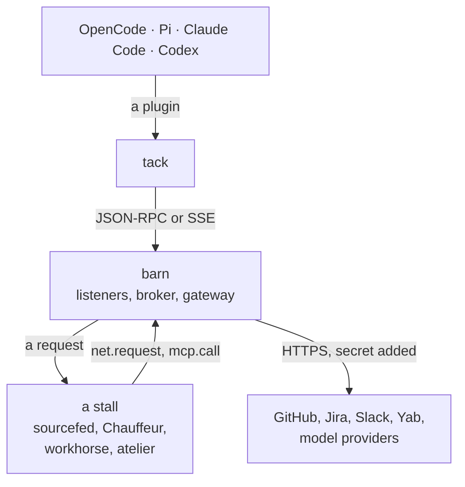
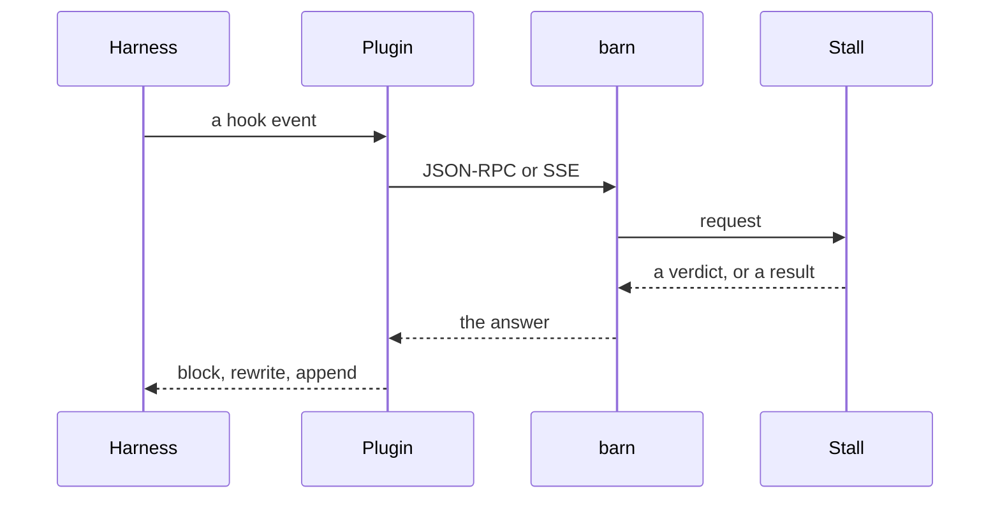
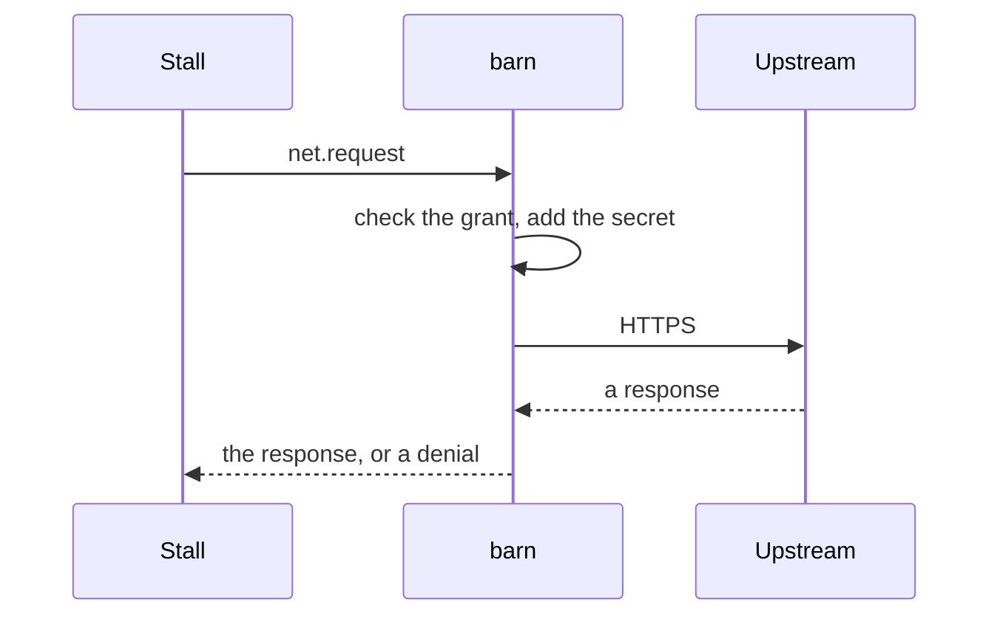
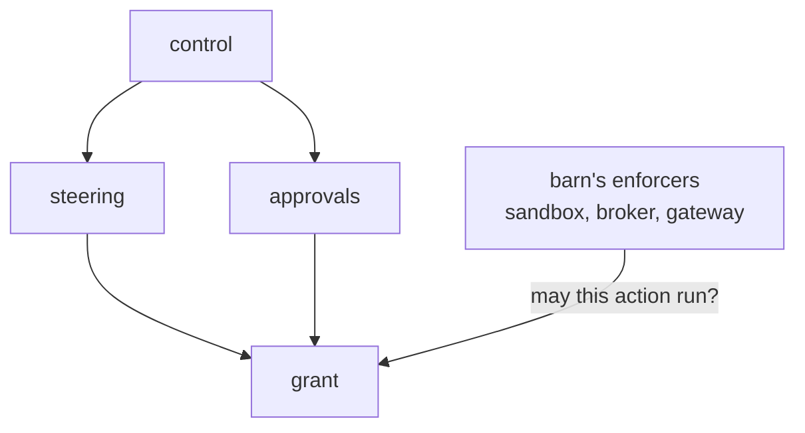
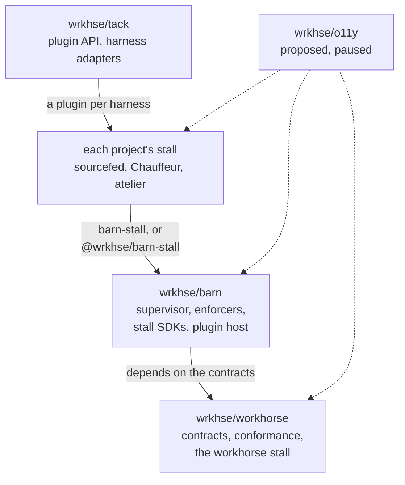
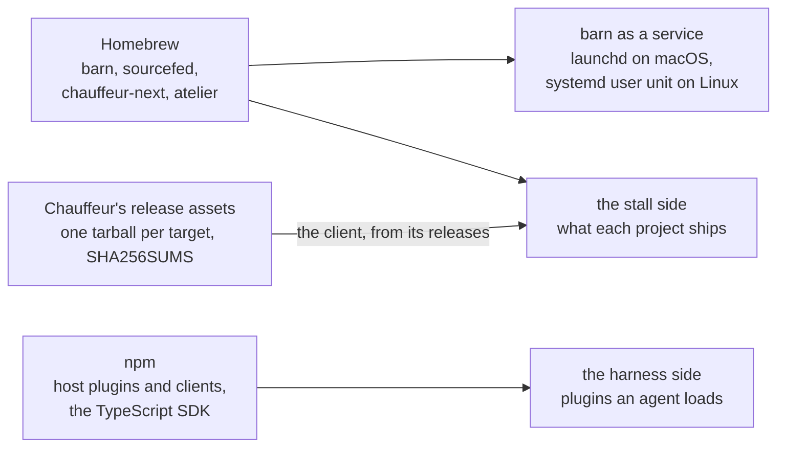
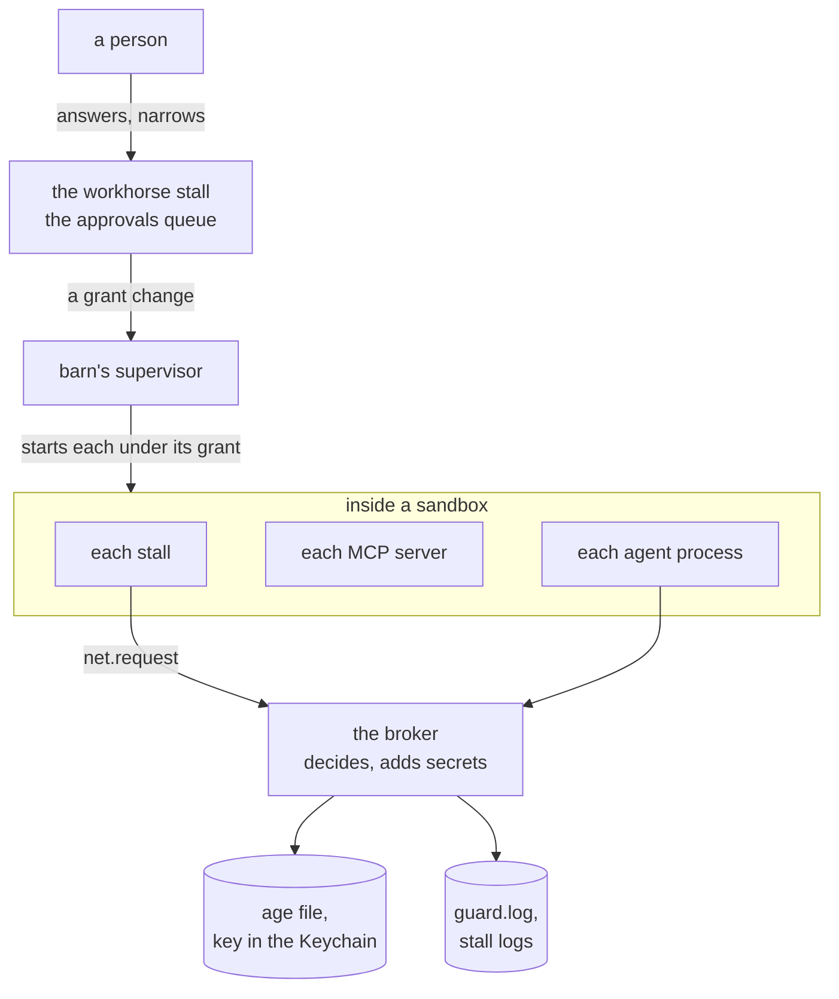

# Architecture

**Status:** being built. B0, barn's repository and its gates, is in place, and
B1, the stall protocol and the supervisor, is in progress. Each part below
carries its own status, and the picture is the system with every approved plan
complete. [The barn plan](https://github.com/wrkhse/barn/issues/1) builds it;
[OVERVIEW.md](OVERVIEW.md) says what the protocols are.

Workhorse is one daemon and a set of contracts. **barn** is the only daemon on a
wrkhse machine. Each project ships a **stall**: an adapter holding only its own
logic, which is its request handlers, its background jobs such as polling, and
the events it emits. barn starts each stall in its own sandboxed child process,
holds every listener a client connects to, and owns what a stall must not do for
itself: the sandbox, the only network exit, secrets, budgets, webhooks, MCP
servers and upgrades.

The contracts, [`grant`](modules/grant.md), [`steering`](modules/steering.md),
[`approvals`](modules/approvals.md) and [`control`](modules/control.md), live in
this repository. The enforcers, [`sandbox`](modules/sandbox.md),
[`broker`](modules/broker.md) and [`gateway`](modules/gateway.md), live in barn.
A stall names a secret and never reads it, opens no socket barn does not hold, and
reaches the network only through barn's broker.

## The runtime

An agent harness reaches a project's plugin through tack. The plugin talks to its
stall through a listener barn holds, and barn reaches the stall over the
connection the stall opened.

atelier runs its builders as agent sessions rather than as a plugin in the
harness, and its own logic reaches barn as a stall last (B10).

## A request's path

A stall needs the network. It asks barn from the same socket the request arrived on.

One path carries a judgement and an event. Chauffeur's plugin asks its stall
whether an action may run before the harness runs it, and sourcefed's stall
pushes a changed item to its plugin over a response stream. Neither carries a
secret: the broker adds it after the request leaves the stall.

## Where the code lives

The contracts depend on each other and on nothing else. barn depends on them,
pinned by tag, and never changes them.

| Module | Code | Status |
| --- | --- | --- |
| [`grant`](modules/grant.md) | the `grant` crate in wrkhse/workhorse | designed; barn's enforcers use it from B1 |
| [`steering`](modules/steering.md) | the `steering` crate in wrkhse/workhorse | designed; the workhorse stall evaluates rules at B9 |
| [`approvals`](modules/approvals.md) | the `approvals` crate in wrkhse/workhorse | designed; the queue lives in the workhorse stall at B9 |
| [`control`](modules/control.md) | the `control` crate in wrkhse/workhorse | designed; the workhorse stall serves it at B9 |
| [`sandbox`](modules/sandbox.md) | `barn-exec` in wrkhse/barn | B1 on macOS, B6 on Linux |
| [`broker`](modules/broker.md) | `crates/barn` in wrkhse/barn | B2 |
| [`gateway`](modules/gateway.md) | `crates/barn` in wrkhse/barn | B3 |
| [`workhorse`](modules/workhorse.md) | the workhorse stall and CLI in wrkhse/workhorse | B9 |
| [`conformance`](modules/conformance.md) | suites in wrkhse/workhorse | designed; each suite lands with the enforcer it tests |
| [`tack`](modules/tack.md) | wrkhse/tack | T1 in progress |

barn is one repository of four parts. `crates/barn` is the supervisor, the
listeners and the CLI; `crates/barn-stall` is the Rust stall SDK;
`barn-exec` applies a stall's sandbox and then starts it; and
`barn-plugin-host` runs a stall's JavaScript behind one plugin-engine
interface. sourcefed's TypeScript providers run there as JS plugins, one realm
per source type, and the engine itself is being chosen.

sourcefed's triage asks Chauffeur over `@fdcn/chauffeur/client`. sourcefed#29's
triage uses it on today's Node daemon, sourcefed's Rust stall reaches Chauffeur
through a socket grant, and the client lands with chauffeur#23's prerelease,
`rc.5`.

## What ships where

| What | Where | Status |
| --- | --- | --- |
| barn | Homebrew; its formula declares the launchd or systemd service | B0, the repository; the supervisor and the service come in B1 |
| a project's stall | Homebrew, beside the project's binary | sourcefed's at S7, Chauffeur's at B8, atelier's at B10 |
| sourcefed's host plugins and CLI client | npm, `@fdcn/sourcefed` | shipped; the harness side, and they stay after the cutover |
| sourcefed's plugin SDK | npm, plugins in `~/.config/sourcefed/plugins/<name>/` on `defineSource` (sourcefed#31) | planned, P0 to P5 |
| Chauffeur's host adapters | npm, one per harness, built on tack | Chauffeur's slices 8 to 10, from tack's T1 core |
| tack | npm; publishing its own package is open (tack#1) | T1 in progress |
| the TypeScript stall SDK | npm, `@wrkhse/barn-stall`, on Node 26 | planned, B1 |
| the Rust stall SDK | `crates/barn-stall` in barn | planned, B1, and barn#7 carries its first part |
| `barn-plugin-host` | barn, running a stall's JavaScript | planned; the engine is being chosen |
| `@fdcn/chauffeur/client` | a release-asset tarball with `SHA256SUMS` | planned, waiting on chauffeur#23's `rc.5` |

## Trust boundaries

| Question | Answer |
| --- | --- |
| What runs sandboxed | Every stall, every MCP server barn starts, and every agent process, each in its own child process under its own grant |
| Who holds a secret | barn alone: one age file, its key in the macOS Keychain or the Linux Secret Service. A stall names a secret; the broker adds it |
| Who answers for an agent | A person, through the approvals queue in the workhorse stall, from the CLI or from a harness plugin |
| Where the evidence is | barn's `guard.log` records requests, denials, budget deferrals and restarts; each stall writes its own log. [o11y](https://github.com/wrkhse/o11y/issues/1) would add one trace and hash-chained evidence, and is paused |

## The stall protocol

A stall connects back to barn. Before it spawns the stall, barn makes
`~/.local/state/barn/run/<stall>/` readable only by its owner, listens on
`proto.sock` in it, and gives the stall two variables: `BARN_SOCKET`, that path,
and `BARN_TOKEN`, a random token for this spawn alone. The stall connects and
sends `stall.start` with the token first. barn accepts the connection only when
the peer is the child it spawned, checked by its credentials, and the token
matches; the token is spent on first use. A stall that has not started by the
deadline is a failed start under the restart policy, and its stdout and stderr
go into its own log.

barn and a stall then speak JSON-RPC 2.0, one message per line, over that
connection. A line is at most 8 MiB with its newline; an inline body is at most
4 MiB, decoded. `protocol` is an integer, `1` today, and barn speaks the current
version and the one before it. A stall answers its own handlers concurrently, at
most 16 calls in flight, and logs through `log` on a bounded queue.
`barn run <stall>` runs one stall in the foreground under the same guard, for
development and CI.

| Method | Direction | Purpose |
| --- | --- | --- |
| `stall.start` | stall to barn | Its name, the protocol version, the token, its own version and the jobs it declares. barn answers with the stall's state folder, or `-32010` when it cannot speak that version |
| `stall.health`, `stall.drain` | barn to stall | Report health; finish in-flight work and exit within a deadline |
| `job.run` | barn to stall | Run a declared job; barn keeps the timers |
| `request`, `cancel` | barn to stall | A client request from a listener; a cancel or a closed connection |
| `webhook` | barn to stall | A verified delivery |
| `stream.send`, `stream.end` | stall to barn | Write to a response stream, such as SSE |
| `net.request` | stall to barn | One HTTP request through the broker |
| `mcp.call` | stall to barn | Call a tool on an MCP server barn runs |
| `log` | stall to barn | A structured log line |

The fixed parts are barn's
[`docs/stall-protocol.md`](https://github.com/wrkhse/barn/blob/main/docs/stall-protocol.md),
and [barn#7](https://github.com/wrkhse/barn/pull/7) builds them.

## Stalls

| Stall | Holds | Runs | Status |
| --- | --- | --- | --- |
| sourcefed | monitors, polls, events, webhook deliveries | always | first: S0 next |
| Chauffeur | rules, judges, plugins | always | after slice 13, in B8 |
| workhorse | sessions, the approvals queue, steering, `control` | on demand | B9 |
| atelier | one thread per project, `state.json` | always | last, in B10 |

## Status

| Plan | Slices | Status |
| --- | --- | --- |
| [barn#1](https://github.com/wrkhse/barn/issues/1) | B0 to B10 | B0 in place; B1 in progress, in [barn#7](https://github.com/wrkhse/barn/pull/7) |
| [barn#3](https://github.com/wrkhse/barn/pull/3) | the stall-runtime spike | measured; the owner chose the Rust stall |
| [sourcefed#31](https://github.com/wrkhse/sourcefed/issues/31) | P0 to P5 | approved; P0 is S0 |
| [rungs#1](https://github.com/wrkhse/rungs/issues/1) | released | `v0.1.0` |
| [Chauffeur's slices](https://github.com/wrkhse/chauffeur/tree/v2/docs/plans/slices) | 0 to 13 | 0 and 1 implemented; 2 in progress |
| [tack#1](https://github.com/wrkhse/tack/issues/1) | T1 to T8 | T1 in progress |
| [atelier#1](https://github.com/wrkhse/atelier/issues/1) | 0 to 2, then 3, and the stall at B10 | 0 to 2 implemented in #1; 3 in [#43](https://github.com/wrkhse/atelier/issues/43) |
| [Workhorse's milestones](OVERVIEW.md#roadmap) | 1 to 6 | 1 and 2 arrive with B9; 3 and 4 follow with tack and the gateway; 5 and 6 have no plan |
| [o11y#1](https://github.com/wrkhse/o11y/issues/1) | O0 to O7 | proposed, paused |

## Order of work

Each row waits on what its last column names.

| Order | Work | Waits on |
| --- | --- | --- |
| 1 | barn B0: the repository and its gates | in place |
| 2 | barn B1: the stall protocol and the supervisor | B0 |
| 3 | sourcefed S0: the golden harness | sourcefed#29 merged, and B1 |
| 4 | sourcefed S1: schedule as a stall under barn | B1 |
| 5 | barn B2 to B4, with sourcefed S2 to S5 | B1; S2 onwards needs B2 |
| 6 | barn B5 and B6: upgrading one stall, and Linux | B2 to B4 |
| 7 | barn B7: JSON-RPC listeners | B5 and B6 |
| 8 | sourcefed S6 to S8: triage, then the cutover | B5 and B6 |
| 9 | barn B8: the Chauffeur stall | B7, and Chauffeur's slice 13 |
| 10 | barn B9: the workhorse stall | S6 to S8 |
| 11 | barn B10: the atelier stall | B9 |
| in step | tack T1 to T8 | alongside; T1 unblocks Chauffeur's slice 8 |
| in step | o11y, when the owner resumes it | paused. O0 is independent; O1 waits on B1 and B2, whose envelope accepts `_meta`; O2 and O3 wait on Chauffeur's stack and atelier's D and E; O4 waits on sourcefed's Rust stall |

## Open questions

- Whether every agent resumes a session reliably enough for restart and resume,
  and which steering events each one reports and enforces.
  [Planned spike](spike/resume-and-events/PLAN.md).
- Which engine `barn-plugin-host` settles on. QuickJS through rquickjs and
  earendil-works/djs are the candidates.
- How Chauffeur's plugin processes (its slice 5) run under barn, settled when its
  stall is built.
- Whether tack publishes its own package or ships inside Chauffeur's adapters
  until `1.0.0`: tack#1's open question.
- Whether o11y's store lives in one file under barn's state folder, and whether
  `barn explain` may read a harness's own session log: o11y#1's open questions.
