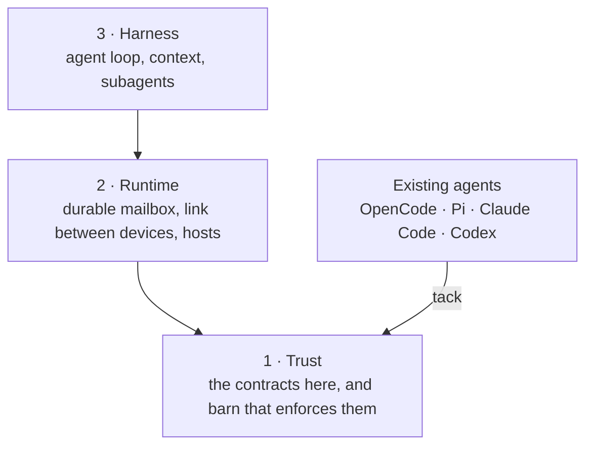
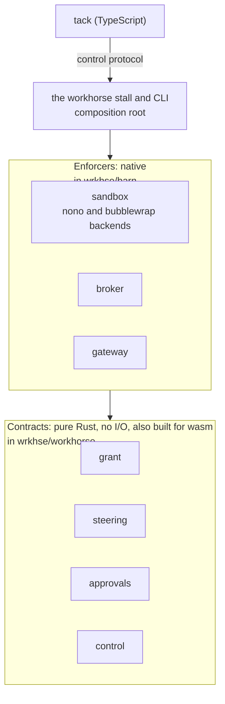
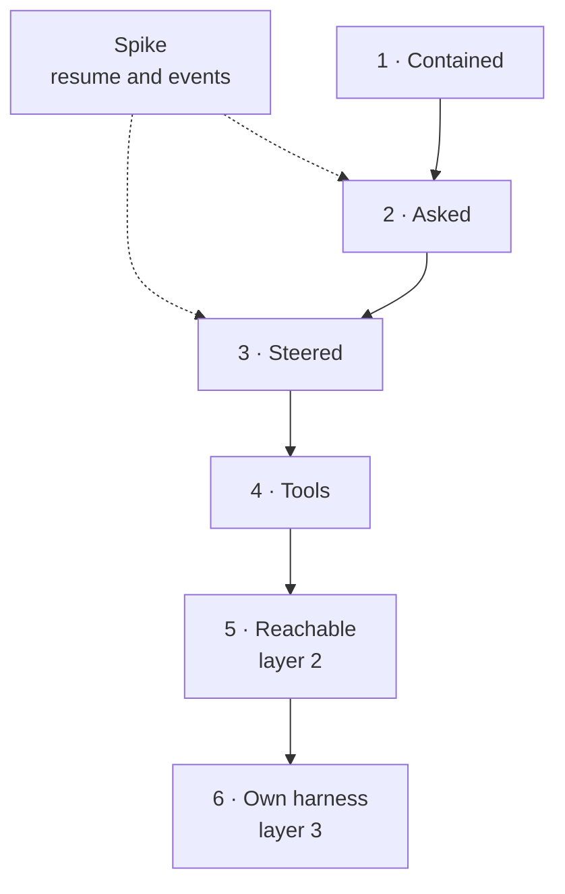

# Overview

**Status:** agreed direction, being built in barn. The contracts on this page are
designed, and nothing in this repository is built. barn builds the enforcers and
the supervisor, and each project's stall follows. [ARCHITECTURE.md](ARCHITECTURE.md)
shows the parts and where each one's code lives.

## What Workhorse is

Workhorse is a set of open protocols in three layers, on one daemon. Each layer
depends only on the layers below it, and each can be used without the layers
above it. barn, the only daemon, runs every project's stall and enforces layer 1.

The first user is one developer running existing coding agents on a laptop and a
home server, who wants them safe, steerable and observable. That user needs
layer 1 only, so layer 1 comes first.

## Layer 1: Trust

Whatever the harness, an agent reaches files, network, secrets and tools only
through these, and a person can see and change all of it.

| Protocol | Question it answers |
|---|---|
| [**Grants**](modules/grant.md) | What may this agent touch: paths, hosts, secrets by name, tools |
| [**Sandbox**](modules/sandbox.md) | How an operating system enforces a grant (nono on macOS, bubblewrap on Linux) |
| [**Broker**](modules/broker.md) | How network traffic leaves, with secrets added outside the agent so the agent never holds them |
| [**Tool gateway**](modules/gateway.md) | How an agent reaches MCP servers through one door that applies its grant |
| [**Steering**](modules/steering.md) | Rules that fire on an agent's events and block, rewrite, or ask a person |
| [**Approvals**](modules/approvals.md) | How a person answers a request for a decision: a steering "ask" or a request to widen a grant |
| [**Control**](modules/control.md) | How a person, the CLI and tack talk to the other six: sessions, grants, approvals, steering verdicts |

The contracts live in this repository: a grant, the rules that steer an agent,
the approvals queue, and the protocol a client speaks. barn enforces them:
`barn-exec` applies a stall's sandbox, the broker is the only network exit, and
the gateway is the one door to MCP servers. barn starts each stall, and each
agent and local MCP server, in its own child process under its own grant.

In short: a grant belongs to one session and is made from a profile in the
person's config. Everything is denied unless listed. A person can narrow a grant
at any time, and it widens only by approval. All network traffic goes through the
broker. Steering works inside the grant and never widens it. Every module's
decisions, open questions and evidence are in its own file under
[`modules/`](modules/).

## Layer 2: Runtime

Planned. Agents that outlive a terminal: a durable mailbox (an agent is a log
plus an inbox), a link between devices, and a contract for hosts (native, workerd
or Cloudflare, Rivet). Every agent it runs is under a layer 1 grant. Its evidence
is in [`wrkhse/daemon-v0`](https://github.com/wrkhse/daemon-v0); it has no plan
until milestone 5.

## Layer 3: Harness

Planned. The agent loop and its context: compaction, prompt caching, skills,
codemode, subagents. Equestrian, Stable, Mule and Polo are harnesses. Until there
is one, existing agents fill this role, and [HARNESS.md](HARNESS.md) holds the
notes on what a harness owes.

## tack: the bridge

[`@workhorse/tack`](https://github.com/wrkhse/tack) is how existing agents reach
layer 1. A plugin is written once and runs in OpenCode, Pi, Claude Code and Codex.
It carries steering and tool routing into each agent. It is TypeScript because
those agents load JavaScript plugins; its hooks call into layer 1. It is useful on
its own and lives in its own repository. T1, the core with OpenCode and Pi, is in
progress; [tack#1](https://github.com/wrkhse/tack/issues/1) is the plan. See
[`modules/tack.md`](modules/tack.md).

## Rules

- **Adopt standards; invent only where none exists.** MCP for tools, ACP for
  sessions, the OpenAI-compatible API for models. Workhorse defines grants,
  sandbox policy, broker, steering and, later, the mailbox.
- **A protocol is a contract plus a conformance suite.** Rust provides the
  reference implementations; each protocol is its own crate, usable alone.
- **One-way dependencies.** Layer 1 knows nothing of layers 2 and 3. Contracts
  depend on other contracts, with `grant` at the bottom.
- **One daemon.** A project ships a stall and never a daemon of its own.
  `barn run <stall>` runs one in the foreground for development and CI, and
  barn holds every listener a client connects to.

## Modules

These are layer 1's modules. Crates follow protocol boundaries; processes are a
deployment choice, and the process is barn's.

Arrows mean "depends on". Contracts depend only on other contracts, with `grant`
at the bottom: `steering` and `approvals` use it, and `control` carries all
three. Enforcers depend only on contracts, never on each other, and live in barn.

| Module | Kind | Owns |
|---|---|---|
| [`grant`](modules/grant.md) | Contract | Grant and profile schema; whether a grant allows an action; narrowing, and widening by approval |
| [`steering`](modules/steering.md) | Contract | Normalized agent events, the rule format, and verdicts: allow, block, rewrite, ask |
| [`approvals`](modules/approvals.md) | Contract | Request and answer records, the queue's state machine, request IDs |
| [`control`](modules/control.md) | Contract | JSON-RPC methods for sessions, grants, approvals and steering; used by tack, the CLI and a phone |
| [`sandbox`](modules/sandbox.md) | Enforcer | Turns a grant into an OS policy and starts the process under it, with nono and bubblewrap backends |
| [`broker`](modules/broker.md) | Enforcer | The one network exit: checks the grant, adds secrets, logs every request, never follows a redirect |
| [`gateway`](modules/gateway.md) | Enforcer | An MCP proxy that exposes only the tools a grant lists |
| [`workhorse`](modules/workhorse.md) | Composition root | The workhorse stall (`control`, sessions, approvals, steering) and the CLI; the only place implementations are chosen |
| [`conformance`](modules/conformance.md) | Test suites | One suite per protocol: grant vectors, escape probes, egress tests |
| [`tack`](modules/tack.md) | Bridge | In its own repository: forwards agent hook events over `control` and applies verdicts |

Where each one's code lives, and its slice, is in
[ARCHITECTURE.md](ARCHITECTURE.md#where-the-code-lives).

| Concern | Decision |
|---|---|
| Contracts | Schemas, serialization and rules only, no I/O, so they also build for wasm. barn depends on them by tag and never changes them |
| Processes | One daemon, barn, which starts each stall in its own sandboxed child process. Agents and local MCP servers run under their own grants too |
| Inside the sandbox | The broker is the only destination. tack reaches `control` through it on a reserved path, with a per-session token and a smaller set of methods |
| Standards | MCP for the gateway, JSON-RPC for `control`, ACP for sessions. Workhorse defines only the grant, steering and approval formats and the `control` methods |

## Roadmap

**Status:** agreed. Milestones 1 and 2 are barn's work; nothing in this
repository is built.

Each milestone is a vertical slice: the smallest set of modules that gives the
first user something complete, through its real boundaries, on macOS and on the
homelab's Linux. A milestone ends when its conformance suites pass, each with a
deliberate break that makes it fail, and a real agent does real work under it.

| Milestone | Delivers | Done when |
|---|---|---|
| **1 · Contained** | [`grant`](modules/grant.md), [`sandbox`](modules/sandbox.md) and [`broker`](modules/broker.md), in barn's B1 and B2, with the workhorse stall's status command in B9 | OpenCode completes a task with a real model under a profile. The model key reaches the provider through the broker and never appears in the agent's files or environment. A request outside the grant is denied and logged. Escape and egress suites pass |
| **2 · Asked** | [`approvals`](modules/approvals.md) and [`control`](modules/control.md) on the Unix socket, live narrowing, widening by approval, restart and resume for file changes (B9) | A request to a host outside the grant appears in the queue. Answering it from the CLI as "once" or "add to the grant" takes effect; an unanswered one is denied at its timeout. A file-grant change restarts and resumes the session |
| **3 · Steered** | [`steering`](modules/steering.md), and [`tack`](modules/tack.md) with `control` through the broker: OpenCode first, because its in-process plugin can fail closed and rewrite tool input; then Pi, Claude Code and Codex | A rule such as "ask before `git push`" stops the push until it is answered, in every agent. With barn down, the push stays blocked |
| **4 · Tools** | [`gateway`](modules/gateway.md) in barn's B3, and local MCP servers in their own sandboxes | An agent sees and calls only the tools its grant lists. Each server's network traffic goes through the broker |
| **5 · Reachable** | Layer 2: the link between devices and durable sessions, built from the evidence in [`wrkhse/daemon-v0`](https://github.com/wrkhse/daemon-v0) | An approval is answered from a phone, and an agent session on the homelab survives a restart of the daemon. No plan yet |
| **6 · Own harness** | Layer 3: the first harness from [HARNESS.md](HARNESS.md) | Not planned until milestone 5 is done |

The [resume and events spike](spike/resume-and-events/PLAN.md) runs alongside
milestone 1. Its results shape restart and resume in milestone 2 and the steering
events tack relies on in milestone 3.

## Open questions

Each module's own open questions are in its file, and the ones that span modules
are in [ARCHITECTURE.md](ARCHITECTURE.md#open-questions).

## Evidence

Prior work is evidence, not design. [`wrkhse/daemon-v0`](https://github.com/wrkhse/daemon-v0)
holds the capability daemon, the sandbox, link, transport, workerd, kernel and
agentOS spikes, and the uniform-stack proposal. [`wrkhse/workhorse-legacy`](https://github.com/wrkhse/workhorse-legacy)
and [`wrkhse/fleet-v0`](https://github.com/wrkhse/fleet-v0) hold older versions of
Workhorse. All three are archived. [`evidence/`](evidence/) holds notes on outside
projects and what Workhorse takes from each, starting with
[nanocode](evidence/nanocode.md).
