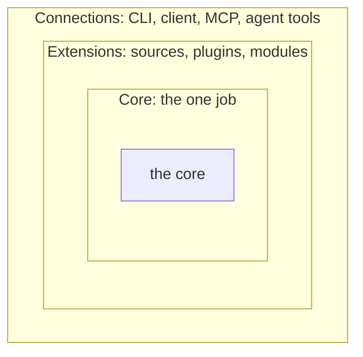
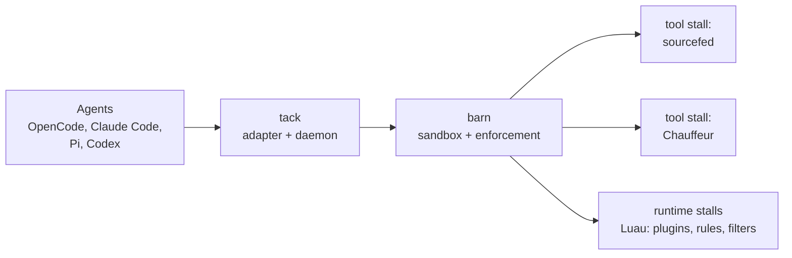
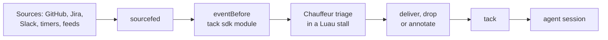
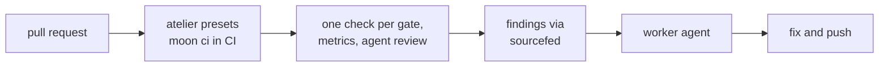

# Philosophy

## What code should be in the age of agents

Agents make it cheap to generate code.
Now, the quality of code is non-deterministic.

No matter what Boris Cherny says, coding is **not solved**.

So how do we leverage the power of agents without giving in to the issues?

## How I build

Four principles run through every project here.

**Think top-down, build bottom-up.**

I design from what a project is for down to its concrete API, and I do it in
issues. One master issue holds the shape. Each sub-issue goes deep on one
problem and carries a code outline, so the direction gets judged before any
code exists. Building goes the other way: one sub-issue per pull request, the
smallest working piece first, and every piece grows from things that already
work.

> Prior art: Niklaus Wirth, "Program Development by Stepwise Refinement"
> (CACM, 1971); Gall's law (John Gall, _Systemantics_): "A complex system that
> works is invariably found to have evolved from a simple system that worked.
> A complex system designed from scratch never works and cannot be patched up
> to make it work."

**Never trust, always verify.**

Nothing is done just because someone says it is, me or an agent. Data gets
checked once, where it enters, by a schema, and from then on it is a type the
code can rely on. What matters gets proven: property tests, proofs where they
fit, mutation testing. atelier's gates are the model: every check runs in a
contained environment, and nothing lands until they all pass. A feature is
done when a recording shows it working end to end. Every pull request gets an
independent review and CI before it merges.

> Prior art: Alexis King, "Parse, don't validate" (2019); zero trust's "never
> trust, always verify".

**Suckless.**

Every project has an indivisible core: the one thing it does, the part you
can't remove without the project stopping being itself, and the part that can
be extended without end. I strip the core until nothing more can go.
Everything else is built outward and plugs into it. Extensions load at run
time, and connections are how people, programs and agents reach it. In
sourcefed, a plugin is a Luau hook the daemon runs in a barn stall, while the
CLI connects to it.

This is how I think about each project's design, including pieces that are
not built yet:

| Project   | Core                                                                                        | Extensions                                                                                           | Connections                                                                             | Status                                                                                     |
| --------- | ------------------------------------------------------------------------------------------- | ---------------------------------------------------------------------------------------------------- | --------------------------------------------------------------------------------------- | ------------------------------------------------------------------------------------------ |
| tack      | a universal agent adapter: one plugin, every harness                                        | modules its compiler builds in: barn-stall, skills, transports, client, opt-in sdk; modules from git | harness adapters for OpenCode, Pi, Claude Code and Codex; MCP server; CLI               | Four harness adapters shipped (v0.1.0-rc.6): OpenCode, Claude Code, Pi, Codex; MCP planned |
| barn      | a sandbox and runtime-stall engine                                                          | stalls, one per tool, plus runtimes (Luau first; QuickJS or V8 later)                                | tack launches it as a program; tools use its stalls; `control` JSON-RPC; listeners; CLI | slice 1 in progress (#21); runtime stalls planned (#23)                                    |
| sourcefed | a source event manager: takes in events from every source and feeds them on                 | Luau sources; plugins such as Chauffeur's triage hook                                                | tack: agent tools, MCP, CLI, client                                                     | TypeScript version live; sourcefed-core prerelease core-v0.1.0-rc.1 (#86 still open)       |
| Chauffeur | a judgment engine: classifies or judges input against the schema and parameters you give it | rules, rulebooks, judges; Luau facts and plugins                                                     | tack: harness adapters, CLI, `ask_chauffeur`; sourcefed sdk hooks                       | Rust core in progress (#57)                                                                |
| atelier   | a CI engine for monorepos: fast contained runs, a versioned results file, one check per gate, affected-only gates, a digest-pinned image, main-only caches, sharding, cancelled superseded runs and tracked CI timing | presets write results (gates per language, metrics, agent review); opt-in apps read results or request runs through sourcefed: metrics history, visualizer, review, docs gate and sweep, simplify, builder — each with its own permissions; no plugins in atelier | agents reach it through tack; apps read results or sourcefed run requests; moon and GitHub checks | design in [atelier#1](https://github.com/wrkhse/atelier/issues/1); Rust gate presets shipped (v0.2.0-rc.1, #87); metrics (#88) and agent review (#89) open |

tack is how tools reach agents: sourcefed and Chauffeur are tools built on tack,
so their connections are the ones tack builds. atelier's core writes a versioned
results file; its apps read that file or request runs through sourcefed, each opt-in
with its own permissions. atelier has no plugins: agents reach it through tack. See
[atelier#1](https://github.com/wrkhse/atelier/issues/1) for the design.
barn is the sandbox and runtime-stall engine. tack runs barn as its own
program: it launches the barn binary, which starts the stall and returns the
host endpoint, a socket path and single-use token, over a pipe. tack talks to
barn through barn-stall's framed protocol; barn-stall is tack's only barn
dependency. Chauffeur and sourcefed run their Luau in barn stalls. Plugin code
runs only in barn's runtime stalls: supervised, sandboxed processes that speak
tack's framed NDJSON protocol. No runtime loads into tack's daemon. Projects
extend each other the same way they extend themselves: Chauffeur's triage
plugin runs on sourcefed through tack's sdk hooks.

Where things run:

An event reaching an agent:

A pull request through atelier:

> Prior art: the suckless.org philosophy, "simplicity, clarity and frugality"
> and "Designing simple and elegant software is far more difficult than
> letting ad-hoc or over-ambitious features obscure the code over time.";
> Jochen Liedtke's minimality principle ("On µ-Kernel Construction", SOSP
> 1995): "A concept is tolerated inside the microkernel only if moving it
> outside the kernel, i.e. permitting competing implementations, would
> prevent the implementation of the system's required functionality.";
> Bertrand Meyer's open–closed principle: open for extension, closed for
> modification.

**Build atomic.**

Suckless is about what goes in the core; this is about how every piece is
cut. Each piece does one job and owns a hard boundary (a crate, a module, a
package), decoupled from the rest, so it can be understood, replaced and
tested on its own. Hard boundaries make a project easier for a person to
reason about, and far easier for an agent, which only sees a small part at a
time. The reasoning is in [Code separation](#design-a-framework) below.

> Prior art: Doug McIlroy's Unix philosophy (Bell System Technical Journal,
> 1978): "Write programs that do one thing and do it well. Write programs to
> work together."; David Parnas, "On the Criteria To Be Used in Decomposing
> Systems into Modules" (CACM, 1972); the single-responsibility principle
> (Robert C. Martin, _Clean Code_).

## Design a framework

As a framework author myself, I noticed a couple things from both building and how users use a framework.

1. **Code separation**
   From building, I realised that how much ever you WANT to separate concerns, unless you fully know what you want to build and how to build it, your perfectly separated "sections" will have cross-contamination.
   So, does that mean to completely abandon the idea? HECK NO. In fact, make the boundaries harder and clearer. The best thing about LLMs is that they allow you to cut yourself quicker so you have more time to recover.

One thing that I realised with building frameworks is that proper code separation allows the code to be self-descriptive, cleaner, and lot less headache to deal with, if done the right way.

Go and Rust have it figured it out with the crate and module separation, but Typescript is a lot more confusing with their monorepo situation. Unless you make it a separate publishable package, it's really difficult to create a separate package / module for a certain purpose. But once you do it, you know exactly what that package is for and what should live there. Architecture becomes a lot cleaner, and you have happy days.

If you use an interpreted language, you might suffer from performance issues, and overall, a bundle increase.

2. **Make it diffcult to make the wrong decisions**
   When building out the framework, I noticed that if you give the developer too many options / too much freedom they often most likely make the worst decision possible. This is why Go / Rust became so popular. They made it really diffcult to make wrong decisions. You would have to think through your decision, and more often than not, you land in the right place.

Too much freedom is not good.

### How do agents fit in?

Agents are like humans, but much less perceptive. They miss the larger picture and they can often focus on the wrong details. We do it too, but we learn from our mistakes. Agents might get there in time, but not right now.

So what makes something easier for humans to implement, makes it REALLY easy for agents to implement.
What's easy for humans to mess up in, agents mess up even more.

Most coding philosophies and practices written over time like TigerStyle were written ensure that the human developer make as little mistakes as possible.

It seems like we're in an age of rediscovery of these practices. ASD-STE100, Clean Code; these have become so much more important now because of this.

But mine are these: componentize / modularize code, stricter API.

Also, this does not make agents do hidden work. Whatever an agent is doing should be viewable and tweakable by a human.
