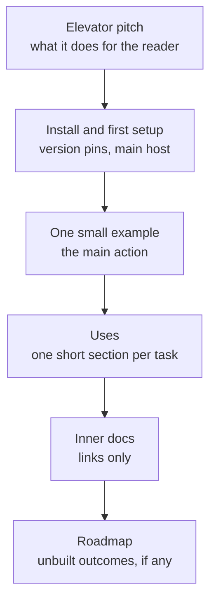
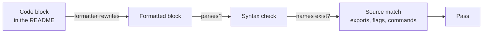

# Repository standards

**Status:** in force for every repository in the `wrkhse` organization. This page
is the canonical place for the README prose standard. Automation for code
examples and generated reference is built after the first end-to-end flow, as
atelier's slice 12, "Code examples that stay true".

A repository README answers one question: how does a person or an agent use
this project? Implementation lives in the inner docs.



## What a README is for

A README is organized by the tasks a reader comes to do: install the project,
run it, wire it into their agent, answer a request it raises. Internals, module
maps and test harnesses belong to the docs the README links to.

The README reads as a finished product ready for a user: it describes what
someone can use, without presenting planned work as shipped. It has no slice
labels, done or in-progress status, or status lines. Unbuilt work appears only
in a short Roadmap checklist at the very bottom.

Sections follow the repository's real uses. A library has a section for each
thing it does; a daemon has one for each command a person runs. No section
exists because a template has a slot for it.

| Part                    | Holds                                           |
| ----------------------- | ----------------------------------------------- |
| Elevator pitch          | What the project does for the reader            |
| Install and first setup | Install, first run and the main host, with pins |
| Example                 | One small illustration of the main action       |
| Uses                    | One short section for each task                 |
| Inner docs              | Links to the full spec                          |
| Roadmap                 | An optional checklist of unbuilt outcomes       |

## Prose

- A section is short and covers one use. A reader who comes for one task
  reads one section.
- Sections split by use, never by internal component: "Review a pull
  request", not "The review engine".
- A long run of undifferentiated text is split by use, or cut.
- Prose is present tense and wraps at 85 columns.

## Elevator pitch

The README opens with what the project does for the reader, in one or two
short paragraphs. The pitch stays as the README grows.

## Install and first setup

Install and first setup stay in the README, including the main host
integration, such as OpenCode. Each install command pins its version.

## The example

One small, self-contained example shows the main action, and a reader
understands it without opening another file.

- Definitions are inline: no imports from the project's real source, and no
  separate variable where a direct definition reads better.
- It shows the main action only. A second use case belongs in its own section.
- It carries no implementation trivia: no source map, internal page
  reference or test harness.
- A sketch says it is a sketch on the line above it.

The skeleton below shows the shape of a README for a fictional project.

````markdown
# tidepool

tidepool turns a folder of Markdown notes into a searchable site. Point it at
your notes and read them in a browser.

## Install

Install with `bun add -g tidepool@2.1.0`. For OpenCode, add the plugin at the
same version: `"plugins": ["tidepool@2.1.0"]`.

## Publish a folder

```bash
tidepool build notes/   # writes site/, one page per note
```

## More

[Architecture](docs/architecture.md) · [Plugin API](docs/plugins.md)

## Roadmap

- [ ] Themes
````

## Inner docs

The README links to the inner docs for a reader who wants the full spec. It
does not repeat their content.

## Roadmap

When work is unbuilt, the README ends with a short checklist of unbuilt
outcomes, one unchecked `- [ ]` item per outcome. A finished project has none.

## Code examples stay true

Every code example is truthful and formatted. A formatting problem in an
example is fixed by its tool before the checks run, not reported as a content
error. Repository files are different: the `format` check fails when a tracked
file is unformatted.



- **Format:** the formatter for the block's language rewrites it in place.
- **Syntax:** the block parses in its language. A sketch is checked for syntax
  only.
- **Source match:** the calls, flags and commands in the block exist in the
  source it documents, with arguments the source accepts.

The README stays hand-written and organized by task. Its examples run as tests:
README doctests in Rust library crates, and trycmd for CLI console blocks.

## Generated reference

Reference is generated from code, never hand-written, and committed to each
repository's `docs/reference`. The hub pulls `docs/reference` into each
project's Reference pages. A CI check regenerates it and fails when the
committed files differ from the code.

| Reference              | Generated from       | With                     |
| ---------------------- | -------------------- | ------------------------ |
| CLI commands and flags | The clap definitions | clap-markdown or similar |
| Config and protocol    | The Rust types       | schemars, as JSON Schema |

## Issues and pull requests

Issues and pull requests follow
[issues-and-pull-requests.md](issues-and-pull-requests.md).

## Enforcement

| Part                         | Held by                                           |
| ---------------------------- | ------------------------------------------------- |
| README prose, this page      | Review against this page                          |
| Code examples that stay true | README doctests and trycmd in CI (slice 12)       |
| Generated reference          | CI staleness check on `docs/reference` (slice 12) |

Slice 12 is atelier's "Code examples that stay true", built after the first
end-to-end flow.

## Decided

| Choice                                                                                                                            | By    | When       |
| --------------------------------------------------------------------------------------------------------------------------------- | ----- | ---------- |
| Homebrew distribution for every released Workhorse product, through a new org tap — installs are `brew install wrkhse/tap/<name>` | owner | 2026-11-27 |
