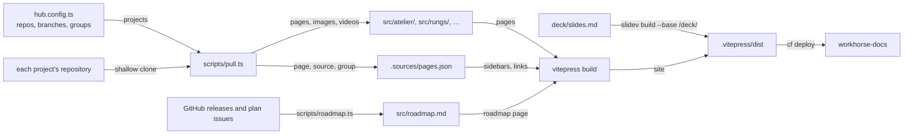

# Site

The hub: the Workhorse family's docs in one site, rendered with
[VitePress](https://vitepress.dev), with Mermaid diagrams drawn and local
search, and the [deck](../deck/slides.md) at `/deck`. It is deployed to
Cloudflare as the Worker `workhorse-docs` from `main`.

Each project's pages are pulled from its own repository when the site
builds, at the branch [`hub.config.ts`](../hub.config.ts) names; that file
is the only place a repository's owner, name or branch appears. Workhorse's
own pages come from this checkout, so a pull request shows its own changes.
The pages are an allow-list: `hub.config.ts` names, for each project, the
page its section opens on and globs for its Guides, Reference, Design and
Code, and only those are pulled. A glob that matches nothing is logged and
skipped. A page whose status line says Planned or Held is left out, because
planned design lives in issues.

| Path                    | Holds                                                                                                                                                                                                                                                                     |
| ----------------------- | ------------------------------------------------------------------------------------------------------------------------------------------------------------------------------------------------------------------------------------------------------------------------- |
| `scripts/pull.ts`       | Clones each project at its branch, selects its pages by group, and copies them, and the images and videos they show, under `src/<project>/`; copies the recordings `deck/slides.md` names into `deck/media/`, from each project's `demos` branch; then writes the roadmap |
| `scripts/select.ts`     | Chooses each project's pages from its groups and drops Planned or Held pages; `select.test.ts` checks it                                                                                                                                                                  |
| `scripts/roadmap.ts`    | Writes the roadmap from each project's latest release and plan issue; `roadmap.test.ts` checks it                                                                                                                                                                         |
| `src/`                  | The hub's own pages; the pulled ones beside them and the generated `roadmap.md` are ignored by git                                                                                                                                                                        |
| `.vitepress/config.mts` | The sidebar for the hub and for each project, edit links to each page's own repository; each project's sidebar shows Overview, Guides, Reference, Design and Code, in that order, with Code collapsed and empty groups left out                                           |
| `.vitepress/links.ts`   | Keeps links to pulled pages on the site, and sends links to code to GitHub at the pulled branch; `links.test.ts` checks it                                                                                                                                                |
| `.vitepress/theme/`     | Draws `mermaid` blocks in the site's font and colours, fitted to a readable size, full screen on a click                                                                                                                                                                  |
| `cloudflare.config.ts`  | The Worker and its account; `wrangler.config.ts` names the folder it serves                                                                                                                                                                                               |

- **Run:** `bun install` here and in `../deck`, then `bun run dev`. Every
  pull reads the GitHub API for the roadmap, about two requests per project,
  so set a token first to stay inside the unauthenticated rate limit:
  `GITHUB_TOKEN=$(gh auth token) bun run dev`.
- **Test:** `bun run test` checks link rewriting, page selection and the
  roadmap's rendering.
- **Build:** `bun run build` pulls every project, builds the site and the
  deck into `.vitepress/dist/`, and fails on a dead link in the hub's own
  pages. It reads `GITHUB_TOKEN` for the roadmap when it is set.
- **Deploy:** `.github/workflows/docs.yml` builds every pull request, and
  deploys each push to `main` and a daily build with `CLOUDFLARE_API_TOKEN`,
  so changes in the projects' repositories reach the hub within a day.
- **Links in pulled pages:** a relative link, or a GitHub link under the
  project's owner or a former one, to a page the hub pulled stays on the
  site; a link to anything else goes to GitHub at the configured branch. A
  missing image is read from GitHub, so a project's mistake never fails the
  hub's build. `formerOwners` in [`hub.config.ts`](../hub.config.ts) names
  former owners whose links can be rewritten; GitHub redirects those that
  stay external.
- **Diagrams** use Mermaid's `base` theme, classic look and dagre layout, in
  the site's colours, light or dark. Each fits its column, never below 75% of
  its natural size; a wider one scrolls sideways.
