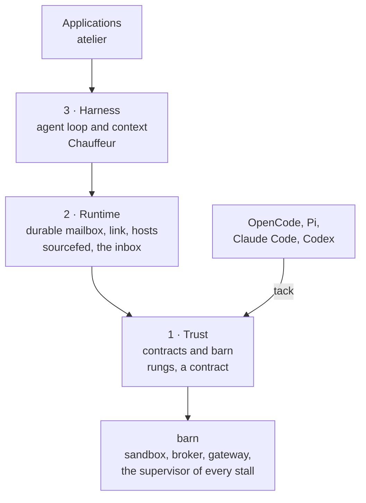

# How the projects connect

Each project is useful alone. Together, barn runs them, sourcefed tells the
others what changed, rungs runs their plans, Chauffeur steers the agents, and
atelier turns issues into pull requests. [The architecture](/workhorse/ARCHITECTURE)
draws the whole system; this page is the list of edges between the projects.

| From | To | What crosses | Where it's planned |
| --- | --- | --- | --- |
| an agent harness | a project's plugin | a hook event: a tool before and after, a prompt sent, a session idle | [tack#1](https://github.com/wrkhse/tack/issues/1) |
| a project's plugin | its stall | JSON-RPC over a socket, or HTTP with SSE, on a listener barn holds | [barn#1](https://github.com/wrkhse/barn/issues/1) |
| a stall | the network | `net.request` through barn's broker, which checks the grant and adds a secret by name | [barn#1](https://github.com/wrkhse/barn/issues/1) |
| a stall | an MCP server | `mcp.call` through barn's gateway | [barn#1](https://github.com/wrkhse/barn/issues/1) |
| GitHub, Slack | a stall | a webhook delivery barn verified | [barn#1](https://github.com/wrkhse/barn/issues/1) |
| sourcefed | atelier | `item.matched` and `schedule.fired`, acknowledged once atelier saves the run | [atelier#42](https://github.com/wrkhse/atelier/issues/42) |
| sourcefed | Chauffeur | `@fdcn/chauffeur/client`: each event, asked about before it is queued, so every host gets one filtered stream | [sourcefed#27](https://github.com/wrkhse/sourcefed/issues/27), [Chauffeur slice 2](/chauffeur/docs/plans/slices/slice-2) |
| rungs | atelier | the step machine inside every pipeline | [atelier#43](https://github.com/wrkhse/atelier/issues/43) |
| rungs | Chauffeur | the step machine inside every strategy | [Chauffeur slice 3](/chauffeur/docs/plans/slices/slice-3) |
| atelier | an agent session | a builder in its own worktree, from the base branch | [atelier](/atelier/docs/plans/slices/slice-1) |
| atelier | Chauffeur | Chauffeur's issues built into pull requests | [chauffeur#5](https://github.com/wrkhse/chauffeur/issues/5) |
| tack | every harness | one plugin, written once, loaded natively by each agent | [tack#1](https://github.com/wrkhse/tack/issues/1) |

## Where each sits in Workhorse's layers

Workhorse is three layers of protocols, each depending only on those below it
([overview](/workhorse/OVERVIEW)). The projects sit at these places in it:

| Project | Place | Why |
| --- | --- | --- |
| rungs | A contract, in layer 1's style | Pure Rust with no I/O, `no_std` and proven, as layer 1's contracts are: `grant`, `steering`, `approvals` and `control` |
| barn | Layer 1's enforcers, and the supervisor everything runs on | sandbox, broker and gateway are layer 1's enforcement; the stalls are the processes |
| sourcefed | Layer 2, the inbox | An agent is a log plus an inbox; sourcefed fills the inbox with what changed outside |
| Chauffeur | Layer 3, the harness's context, beside layer 1's steering | It decides what an agent should see and do next; steering's rules decide what it may do |
| atelier | An application above all three | It runs agents to do work: issues in, proven pull requests out |
| tack | The bridge into layer 1 | It carries steering and tool routing into agents that exist today |
