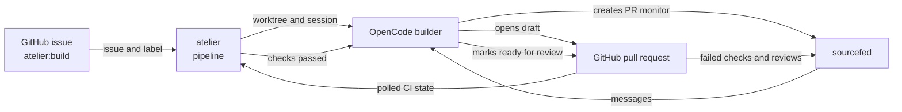
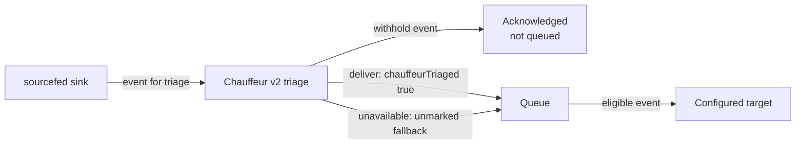

# How it fits

Workhorse projects help a person turn an issue into a pull request and keep
an agent informed as work changes. Each project has its own job: atelier
runs work, sourcefed delivers events, and Chauffeur judges them when asked.

## From label to pull request

Add `atelier:build` to an issue in a watched GitHub project. atelier polls
the issue, claims it and starts a pipeline. Its OpenCode builder works in
its own worktree. In the released `v0.1.0-rc.8`, the
[GitHub adapter's brief](https://github.com/wrkhse/atelier/blob/v0.1.0-rc.8/plugins/github/src/forge.rs#L144-L153)
tells the builder to open a draft pull request and create a sourcefed PR
monitor. Failed checks and reviews reach the builder as messages. atelier
polls GitHub for CI state and tells the builder when checks pass; the builder
marks the pull request ready for review. sourcefed feeds events back to the
builder; it does not start this run.

See [atelier's run machine](https://github.com/wrkhse/atelier/tree/main/crates/core/src/machine)
and its [GitHub](https://github.com/wrkhse/atelier/tree/main/plugins/github)
and [OpenCode](https://github.com/wrkhse/atelier/tree/main/plugins/opencode)
adapters.

## Events and decisions

sourcefed watches sources such as GitHub, Jira and Slack, and delivers
changes to a configured target. A `schedule` monitor emits `schedule.fired`;
a `timer` emits `timer.fired`. For example, a timer can send a reminder to
its configured session target. This delivery does not require atelier.

At its sink, sourcefed can ask Chauffeur v2 to triage an event through the
shipped TypeScript `@fdcn/chauffeur/client` and `navigate`. A verdict can
withhold the event; the sink acknowledges it without queuing it. The
[sink](https://github.com/wrkhse/sourcefed/blob/main/packages/daemon/src/utils/sink.ts#L14-L35)
queues triaged, non-withheld events with `chauffeurTriaged: true`. If no
verdict is available, including when Chauffeur is absent or times out,
the event is queued unmarked. The
[OpenCode bridge](https://github.com/wrkhse/sourcefed/blob/main/adapters/opencode/bridge.ts#L134-L146)
skips its v1 gate only for marked events; unmarked events still pass through
that gate when it is available.
The [sourcefed triage reference](https://github.com/wrkhse/sourcefed/tree/main/packages/daemon/src/triage)
describes the decisions and fallback. Chauffeur also exposes
`chauffeur navigate` to callers; its
[slice 2 reference](/chauffeur/docs/plans/slices/slice-2) describes the
request and response.

## Boundaries and code

atelier runs application work, sourcefed delivers events, and Chauffeur
judges them. [barn](https://github.com/wrkhse/barn/tree/main/docs) holds the
trust specifications.

- **atelier:** [core and pipeline](https://github.com/wrkhse/atelier/tree/main/crates/core),
  [worktrees](https://github.com/wrkhse/atelier/tree/main/crates/git), and
  [plugins](https://github.com/wrkhse/atelier/tree/main/plugins).
  Its run machine depends on rungs on
  [`main`](https://github.com/wrkhse/atelier/blob/main/crates/core/Cargo.toml),
  outside the `v0.1.0-rc.8` release.
- **sourcefed:** [daemon](https://github.com/wrkhse/sourcefed/tree/main/packages/daemon)
  and [SDK](https://github.com/wrkhse/sourcefed/tree/main/packages/sdk).
- **Chauffeur:** [core](https://github.com/wrkhse/chauffeur/tree/v2/crates/core)
  and [daemon](https://github.com/wrkhse/chauffeur/tree/v2/crates/daemon).
  Its core also depends on rungs.
- **tack:** [OpenCode and Pi adapters](https://github.com/wrkhse/tack/tree/main/src/agents)
  and [session support](https://github.com/wrkhse/tack/blob/main/src/session.ts).
- **rungs:** the [step machine](https://github.com/wrkhse/rungs/tree/main).
- **barn:** the [CLI crate](https://github.com/wrkhse/barn/tree/main/crates/barn)
  holds the command-line surface.

Design issues: [barn#1](https://github.com/wrkhse/barn/issues/1),
[tack#1](https://github.com/wrkhse/tack/issues/1),
[tack#25](https://github.com/wrkhse/tack/issues/25) (bridge RFC),
[o11y#1](https://github.com/wrkhse/o11y/issues/1),
[atelier#42](https://github.com/wrkhse/atelier/issues/42) (open),
[sourcefed#31](https://github.com/wrkhse/sourcefed/issues/31).
