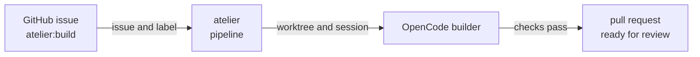
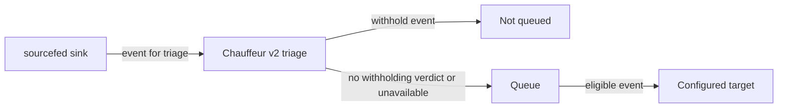

# How it fits

Workhorse projects help a person turn an issue into a pull request and keep
an agent informed as work changes. Each project has its own job: atelier
runs work, sourcefed delivers events, and Chauffeur judges them when asked.

## From label to pull request

Add `atelier:build` to an issue in a watched GitHub project. atelier polls
the issue, claims it and starts a pipeline. Its OpenCode builder works in its
own worktree and opens a draft pull request. When the configured gates pass,
the pull request can be marked ready for review. The pipeline's run machine
uses [rungs](https://github.com/wrkhse/rungs) to decide which steps start,
which are skipped and when the run ends.

See [atelier's run machine](https://github.com/wrkhse/atelier/tree/main/crates/core/src/machine)
and its [GitHub](https://github.com/wrkhse/atelier/tree/main/plugins/github)
and [OpenCode](https://github.com/wrkhse/atelier/tree/main/plugins/opencode)
adapters.

## Events and decisions

sourcefed watches sources such as GitHub, Jira and Slack, and delivers
changes to a configured target. A `schedule` monitor emits `schedule.fired`;
a `timer` emits `timer.fired`. For example, a timer can send a reminder to
its configured session target. This delivery does not require atelier.

At its sink, sourcefed can ask Chauffeur v2 to triage an event through the
shipped TypeScript `@fdcn/chauffeur/client` and `navigate`. A verdict can
withhold the event before it reaches the queue. If no verdict is available,
the event is queued without v2 triage, including when Chauffeur is absent
or times out. OpenCode may still apply its v1 gate to unmarked events.
The [sourcefed triage reference](https://github.com/wrkhse/sourcefed/tree/main/packages/daemon/src/triage)
describes the decisions and fallback. Chauffeur also exposes
`chauffeur navigate` to callers; its
[slice 2 reference](/chauffeur/docs/plans/slices/slice-2) describes the
request and response.

## Boundaries and code

atelier runs application work, sourcefed delivers events, and Chauffeur
judges them. [barn](https://github.com/wrkhse/barn/tree/main/docs) holds the
trust specifications.

- **atelier:** [core and pipeline](https://github.com/wrkhse/atelier/tree/main/crates/core),
  [worktrees](https://github.com/wrkhse/atelier/tree/main/crates/git), and
  [plugins](https://github.com/wrkhse/atelier/tree/main/plugins).
- **sourcefed:** [daemon](https://github.com/wrkhse/sourcefed/tree/main/packages/daemon)
  and [SDK](https://github.com/wrkhse/sourcefed/tree/main/packages/sdk).
- **Chauffeur:** [core](https://github.com/wrkhse/chauffeur/tree/v2/crates/core)
  and [daemon](https://github.com/wrkhse/chauffeur/tree/v2/crates/daemon).
  Its core also depends on rungs.
- **tack:** [OpenCode and Pi adapters](https://github.com/wrkhse/tack/tree/main/src/agents)
  and [session support](https://github.com/wrkhse/tack/tree/main/src/session).
- **rungs:** the [step machine](https://github.com/wrkhse/rungs/tree/main).
- **barn:** the [CLI crate](https://github.com/wrkhse/barn/tree/main/crates/barn)
  holds the command-line surface.

Design issues: [barn#1](https://github.com/wrkhse/barn/issues/1),
[tack#1](https://github.com/wrkhse/tack/issues/1),
[tack#25](https://github.com/wrkhse/tack/issues/25) (bridge RFC),
[o11y#1](https://github.com/wrkhse/o11y/issues/1),
[atelier#42](https://github.com/wrkhse/atelier/issues/42) (open),
[sourcefed#31](https://github.com/wrkhse/sourcefed/issues/31).
