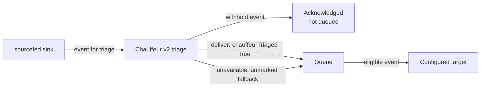

# How it fits

This page describes what runs today: sourcefed delivers events to agents and
programs, and Chauffeur triages them when asked. The
[design](/workhorse/PHILOSOPHY) describes how the projects fit together.

## Events and decisions

sourcefed watches sources such as GitHub, Jira and Slack, and delivers
changes to a configured target. A `schedule` monitor emits `schedule.fired`;
a `timer` emits `timer.fired`. For example, a timer can send a reminder to
its configured session target. This delivery does not require atelier.

At its sink, sourcefed can ask Chauffeur v2 to triage an event through the
shipped TypeScript `@fdcn/chauffeur/client` and `navigate`. A verdict can
withhold the event; the sink acknowledges it without queuing it. The
[sink](https://github.com/wrkhse/sourcefed/blob/main/packages/daemon/src/utils/sink.ts#L14-L35)
queues triaged, non-withheld events with `chauffeurTriaged: true`. If no
verdict is available, including when Chauffeur is absent or times out,
the event is queued unmarked. The
[OpenCode bridge](https://github.com/wrkhse/sourcefed/blob/main/adapters/opencode/bridge.ts#L134-L146)
skips its v1 gate only for marked events; unmarked events still pass through
that gate when it is available.
The [sourcefed triage reference](https://github.com/wrkhse/sourcefed/tree/main/packages/daemon/src/triage)
describes the decisions and fallback. Chauffeur also exposes
`chauffeur navigate` to callers; its
[slice 2 reference](/chauffeur/docs/plans/slices/slice-2) describes the
request and response.

## Boundaries and code

atelier is a CI engine for monorepos, sourcefed delivers events, and Chauffeur
judges them. barn holds design specs for
[grant](https://github.com/wrkhse/barn/issues/14),
[steering](https://github.com/wrkhse/barn/issues/15),
[approvals](https://github.com/wrkhse/barn/issues/16), and
[control](https://github.com/wrkhse/barn/issues/17).
These are design specs, not runtime promises.

- **sourcefed:** [daemon](https://github.com/wrkhse/sourcefed/tree/main/packages/daemon)
  and [SDK](https://github.com/wrkhse/sourcefed/tree/main/packages/sdk).
- **Chauffeur:** [core](https://github.com/wrkhse/chauffeur/tree/v2/crates/core)
  and [daemon](https://github.com/wrkhse/chauffeur/tree/v2/crates/daemon).
- **tack:** [OpenCode adapter](https://github.com/wrkhse/tack/tree/main/adapters/opencode)
  and [daemon](https://github.com/wrkhse/tack/tree/main/crates/daemon/src).
- **barn:** the [CLI crate](https://github.com/wrkhse/barn/tree/main/crates/barn)
  holds the command-line surface.

Master issues: [barn#1](https://github.com/wrkhse/barn/issues/1),
[tack#1](https://github.com/wrkhse/tack/issues/1),
[sourcefed#3](https://github.com/wrkhse/sourcefed/issues/3),
[Chauffeur v2#43](https://github.com/wrkhse/chauffeur/issues/43).

Telemetry is a tack module; its design is in
[tack#90](https://github.com/wrkhse/tack/issues/90).
