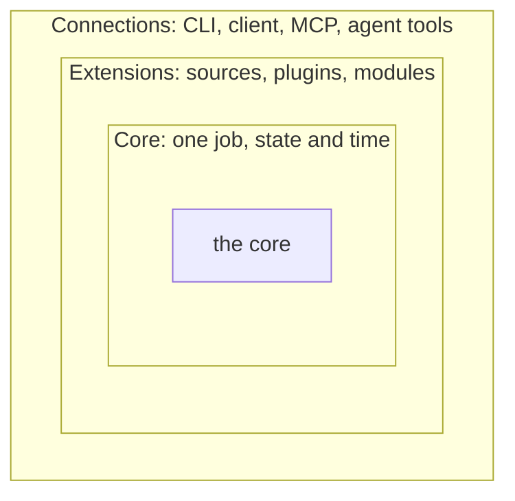

# Workhorse

Workhorse is a family of small projects for making agent work safer, visible
and steerable. Each project does one job and leaves room for people and
programs to build on it.

Each project has a core that keeps state and time, extensions loaded at run
time, and connections for people, programs and agents.

This map shows the projects' designs; not every piece is built. The
[roadmap](/roadmap) shows their status.

| Project | Core | Extensions | Connections |
| --- | --- | --- | --- |
| [sourcefed](/sourcefed/) | the daemon: clock, state, queue | sources, plugins | client, CLI, MCP, agent tools |
| [tack](/tack/) | hooks, tools, session actions | modules: skills, wasm, daemon, transports, client, sdk | the four harness adapters |
| [Chauffeur](/chauffeur/) | the engine: sense, classify, act | rules, rulebooks, judges | adapters, CLI, its sourcefed plugin |
| [barn](https://github.com/wrkhse/barn) | the supervisor and enforcers | stalls | listeners clients connect to |
| [atelier](/atelier/) | the step machine (rungs) | steps, roles, plugins | labels, the sourcefed trigger |

The [contract specs live in barn](https://github.com/wrkhse/barn/tree/main/docs).
See also [o11y's tracing plan](https://github.com/wrkhse/o11y/issues/1).

- [Philosophy](/workhorse/PHILOSOPHY)
- [How it fits](/how-it-fits)
