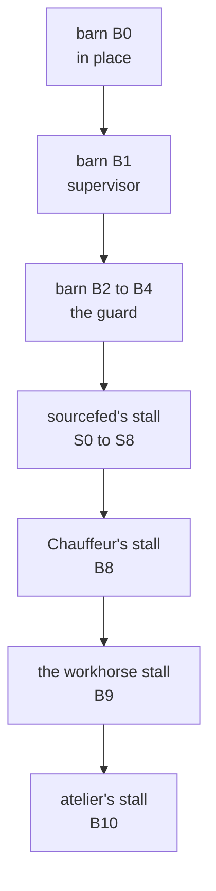

# Roadmap

Each project ships one vertical slice at a time, and its owner reviews each
before the next starts. Each project's plan is the source of truth; this page
says where each one is. [The architecture](/workhorse/ARCHITECTURE#order-of-work)
gives the order the work comes in.

| Project | Now | Next | Plan |
| --- | --- | --- | --- |
| barn | B0: the repository, its gates and the protocol's fixed parts | B1: the supervisor, both stall SDKs and two example stalls | [barn#1](https://github.com/wrkhse/barn/issues/1) |
| Workhorse | The contracts designed; barn builds the enforcers | Milestones 1 and 2, with barn's B9 | [roadmap](/workhorse/OVERVIEW#roadmap) |
| sourcefed | `0.5.1`: issue collections, Jira queries, schedules and program targets, with `daemon.health` | S0, the golden harness, then S1 to S5: its stall is Rust, with the TypeScript providers as plugins | [sourcefed#31](https://github.com/wrkhse/sourcefed/issues/31), [barn#3](https://github.com/wrkhse/barn/pull/3) |
| Chauffeur | v2 slices 0 and 1 implemented, released as `chauffeur-next` `1.0.0-rc.4`; slice 2 in progress | Slices 3 to 13, then its stall in B8 | [slices](/chauffeur/docs/plans/slices/) |
| atelier | Slices 0 to 2 implemented (`0.1.0-rc.7`); slice 3, pipelines made of steps, in progress | Slice 4, the sourcefed trigger; its stall last, in B10 | [#1](https://github.com/wrkhse/atelier/issues/1), [slices](/atelier/docs/plans/) |
| tack | T1 in progress: the core with OpenCode and Pi; part 1 merged, part 2 in review | T2 to T8: session actions, tools, Claude Code, Codex, UI | [tack#1](https://github.com/wrkhse/tack/issues/1) |
| rungs | Released, `v0.1.0`: plans and runs, proven with Kani | Adopted by atelier's pipelines and Chauffeur's strategies | [rungs#1](https://github.com/wrkhse/rungs/issues/1) |
| o11y | Proposed, and paused by the owner | O0, the SDK, when the owner resumes it | [o11y#1](https://github.com/wrkhse/o11y/issues/1) |
